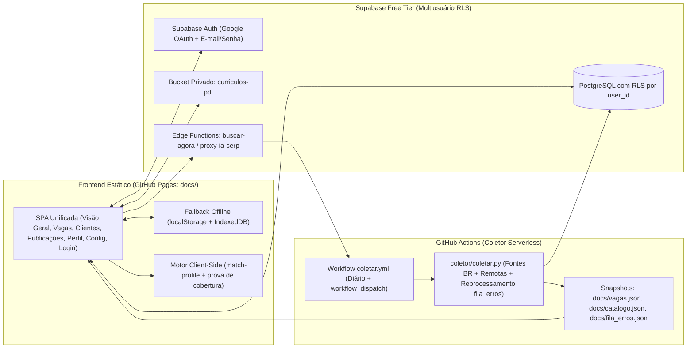
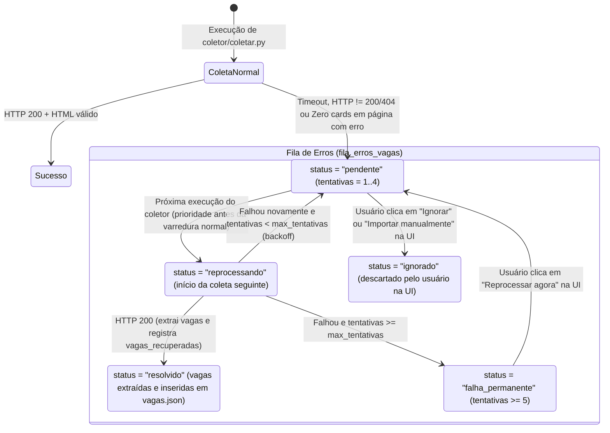

# Especificação de Engenharia Reversa e Arquitetura Multiusuário — Painel Radar

> **Repositório-base analisado (engenharia reversa):** `Dja-Cripto/radar` (`radar-main/`)
> **Repositório-alvo (produção serverless):** `painel-vagas` (`coletor/`, `docs/`, `supabase/`, `.github/workflows/`)
> **Hospedagem e Stack:** GitHub Pages (`docs/`) + Supabase Free Tier (Auth Google & E-mail/Senha + PostgreSQL com RLS por `user_id` + Storage + Edge Functions) + GitHub Actions (Coletor Python diário e sob demanda) + Fallback integral em `localStorage`/`IndexedDB`.

---

## 1. Princípios de Desacoplamento (Zero Dados Fixos no Código)

Na engenharia reversa do `Dja-Cripto/radar` e na análise do `painel-vagas` atual, foram identificados dados pessoais e regionais fixos no código que **devem ser removidos ou parametrizados**:

| Origem | O que estava fixo (Hardcoded) | Como fica na Arquitetura Multiusuário |
| :--- | :--- | :--- |
| `docs/index.html` (`painel-vagas`) | Cabeçalho fixo `"Vagas ... para o Erick, remotas ou em Salvador e RMS"` e `REPO = "egoncalvess/painel-vagas"` | Saudação e subtítulo dinâmicos lidos de `perfis_usuarios` / `configuracoes_usuario` (`nome`, `cargos_alvo`, `cidade_vagas`). Quando sem perfil preenchido, exibe texto neutro (`"Configure seu perfil e cidade em Meu Perfil"`). |
| `supabase/schema.sql` (`painel-vagas`) | `insert into public.permitidos (email) values ('engerickgoncalves@gmail.com')` travando o uso a 1 único e-mail | Política de acesso aberta/convite configurável via tabela `config_acesso` (`modo_aberto = true` por padrão para amigos no mesmo link, ou lista de e-mails/domínios convidados + isolamento total via `user_id = auth.uid()`). |
| `radar-main/workspace.js` | `settingsSeed` fixo em `"Feira de Santana, BA"`, `"https://tel.pandape.infojobs.com.br"`, e link fixo `"Daniel De Jesus Alves.pdf"` | `settingsSeed` e `profileSeed` iniciam vazios/neutros (`name: ""`, `city: ""`, `jobRoles: ""`). O usuário preenche no primeiro acesso (onboarding rápido ou importação de currículo) e salva em `perfis_usuarios` + `localStorage`. |
| `radar-main/match-profile.mjs` | Regra fixa mencionando `"sua graduação em ADS está em andamento"` | Avaliador de compatibilidade (`matchProfile`) lê dinamicamente a lista `academic`, `technical`, `experiences`, `courses`, `projects`, `skillsTech` e `skillsOther` do perfil do usuário logado. |
| `coletor/coletar.py` + `config.json` | Busca restrita apenas aos termos e cidades de 1 pessoa (`config.json`) | O coletor no GitHub Actions une os termos/cidades do `config.json` (padrão) com os termos/cidades ativos em `configuracoes_usuario` no Supabase, gerando um **catálogo compartilhado de vagas** (`public.vagas`), enquanto a nota (`score`), aderência ao currículo e decisões (`marcacoes`) são calculadas por usuário. |

---

## 2. Mapeamento de Engenharia Reversa (`Dja-Cripto/radar` → Serverless Multiusuário)

No `Dja-Cripto/radar`, toda a aplicação dependia de um servidor Node.js local (`server.mjs`) mantendo estado em um único arquivo JSON (`.radar-jobs-state.json`) e autenticação local em `.radar-auth.json`. Abaixo está o mapeamento completo de cada módulo e rota para a arquitetura **GitHub Pages + Supabase + GitHub Actions + Fallback Local**:



### 2.1. Módulo 1: Autenticação e Controle de Acesso (`auth.mjs`, `security-ui.js`, `entrar.html`)
- **Como funciona no Radar original:** Login por usuário/senha em cookie `radar_sessao` (`scrypt`), 2FA opcional via SMTP local, listagem de sessões ativas e eventos de segurança por IP em `.radar-auth.json`.
- **Como fica na arquitetura gratuita (Supabase Auth + Fallback Local):**
  1. **Login Multiusuário no mesmo link:** Suporte simultâneo a **Entrar com Google** (`sb.auth.signInWithOAuth({ provider: 'google' })`), **E-mail e Senha** (`signInWithPassword` / `signUp`) e **Magic Link / Recuperação de senha** (`resetPasswordForEmail`).
  2. **Modo Amigos (Aberto ou Convite):** Em vez de bloquear qualquer usuário diferente de `engerickgoncalves@gmail.com`, a função `public.permitido()` passa a permitir qualquer usuário autenticado quando `config_acesso.modo_aberto = true` (padrão para amigos usarem o mesmo link), mantendo uma lista de bloqueio (`bloqueados`) ou convite opcional. Cada amigo vê **apenas seus próprios dados** graças ao RLS (`user_id = auth.uid()`).
  3. **Modo Visitante / Sem Backend (`localStorage`):** Se `window.SUPABASE` não estiver configurado ou o usuário clicar em *"Usar apenas neste navegador (sem conta)"*, todos os módulos funcionam lendo `docs/vagas.json` + `docs/fila_erros.json` e gravando perfil, decisões, campanhas e posts no `localStorage`. Ao criar conta depois, o frontend sincroniza (faz upsert) do estado local para a conta recém-logada no Supabase.
  4. **Segurança da Conta na UI:** Exibe o e-mail logado, provedor (Google/Senha), opção de alterar senha (`sb.auth.updateUser({ password })`), encerrar sessão atual (`signOut({ scope: 'local' })`) ou todas as sessões (`signOut({ scope: 'global' })`).

### 2.2. Módulo 2: Visão Geral (`index.html#overview`, `app.js`, `jobs-search.js`)
- **Como funciona no Radar original:** Saudação contextual por horário (`Bom dia/Boa tarde/Boa noite, <Nome>`), status do robô (`Robô pronto` / `Última busca há X h`), contadores de ação (`Vagas para revisar`, `Posts para aprovar`, `Empresas para contatar`, `Retornos de hoje`) e cards de destaque com atalho direto para cada módulo.
- **Como fica na arquitetura gratuita:**
  - Calcula os KPIs em tempo real no navegador cruzando:
    - Vagas pendentes de decisão do usuário (`vagas` filtradas pelas preferências de `configuracoes_usuario` menos `marcacoes` onde `status != 'pending'`).
    - Quantidade de itens ativos na **Fila de Erros (`vagas.com.br`)** pendentes de reprocessamento.
    - Posts com `status = 'draft'` ou agendados para hoje em `publicacoes_posts`.
    - Leads com `status = 'new'` ou `follow_up_at <= hoje` em `clientes_leads`.

### 2.3. Módulo 3: Vagas (`sources-br.mjs`, `sources-remote.mjs`, `sources-apis.mjs`, `match-profile.mjs`, `jobs-search.js`, `coletor/coletar.py`)
- **Como funciona no Radar original:**
  - Layout **split-view** (coluna esquerda com lista filtrável/ordenável + navegação por setas `ArrowUp`/`ArrowDown`; coluna direita com ficha completa da vaga).
  - Filtros rápidos (chips de modalidade: `Todas`, `Remoto no Brasil`, `Fora do Brasil`, `Na minha cidade`, `Híbrido`) + filtros por status (`Para revisar`, `Candidatadas`, `Salvas`, `Ajustar`, `Descartadas`), compatibilidade (`Boa`, `Possível`), fonte e busca textual.
  - Ficha de detalhe com: Resumo em português, Evidências encontradas no currículo (`matchProfile`), Pontos a conferir (`gaps`), Sugestão de adaptação do currículo, Perguntas da candidatura (Greenhouse), botão **"Adicionar vaga por link"** (`/api/jobs/manual`), tabela de **Diagnóstico por fonte** (`sourceStats`) e ferramenta de **Prova de Cobertura** (`/api/jobs/coverage`).
- **Como fica na arquitetura gratuita:**
  1. **Coleta Híbrida (Compartilhada + Individual):**
     - `coletor/coletar.py` (no GitHub Actions) coleta todas as fontes públicas (Gupy, Sólides, Vagas.com.br, Empregos.com.br, LinkedIn Guest, SineBahia, Remotive, Jobicy, Himalayas, RemoteOK, Working Nomads, Lever, Greenhouse, GitHub BR Issues) usando a união de termos/cidades dos usuários ativos + `config.json`.
     - Grava as vagas brutas/normalizadas em `public.vagas` (Supabase) e em `docs/vagas.json` + `docs/catalogo.json` (para a Prova de Cobertura).
  2. **Pontuação e Compatibilidade Dinâmica por Usuário (`matchProfile` no Frontend):**
     - Como cada amigo tem um currículo e cidade diferentes, o cálculo de aderência (`score` 0–100, `evidence[]`, `gaps[]`, `resumeSuggestion` e filtro de cidade/modalidade) roda no navegador sobre `public.vagas` usando o `perfis_usuarios` e `configuracoes_usuario` do usuário logado.
  3. **Decisões por Usuário (`public.marcacoes`):**
     - Suporta todos os estados do Radar: `pending` (para revisar), `applied` (me candidatei + data), `saved` (guardar para depois), `approved` (separada para aplicar), `adjustments` (com nota de ajuste), `rejected` (descartada).
  4. **Adicionar Vaga por Link (Manual):**
     - O usuário cola um link ou descrição manual; a vaga é salva em `public.vagas` com `criado_por = auth.uid()` e avaliada imediatamente contra o currículo dele.
  5. **Prova de Cobertura Client-Side:**
     - Compara a lista de links/cargos colada pelo usuário contra `docs/catalogo.json` + `public.vagas` diretamente no navegador (mesma lógica de `coverage()` do `server.mjs`: match por ID na URL, URL limpa ou similaridade de palavras `>= 0.75`).

### 2.4. Módulo 4: Fila Separada de Erros do `vagas.com.br` (Novo Requisito Explícito)
- **Problema:** Buscas por termo ou páginas de detalhe do `vagas.com.br` podem sofrer timeout, erro HTTP (`403`, `429`, `500`, `502`, `503`), bloqueio temporário ou mudança parcial de seletor HTML durante a execução do `coletar.py`.
- **Solução Arquitetural:**
  - Em vez de apenas incrementar um contador genérico de falhas, toda busca ou URL de vaga do `vagas.com.br` que falhar entra na estrutura dedicada **`fila_erros_vagas`** (persistida em `docs/fila_erros.json` e na tabela `public.fila_erros_vagas` no Supabase).
  - Na coleta seguinte, o `coletar.py` lê primeiro os itens pendentes (`status IN ('pendente', 'reprocessando')`) dessa fila antes das buscas normais, aplica backoff e atualiza o status para `resolvido` (quando coleta com sucesso) ou incrementa `tentativas` (marcando `falha_permanente` apenas após o limite configurável, ex.: 5 coletas seguidas, mantendo botão de reprocessar manual).
  - Na interface (aba/gaveta **"Fila de Erros (`vagas.com.br`)"** dentro do módulo Vagas), o usuário visualiza cada URL/termo com erro, código HTTP, horário da última tentativa, quantidade de tentativas e ações: **Abrir link direto no Vagas.com.br**, **Importar vaga manualmente colando o texto**, **Forçar reprocessamento na próxima busca** ou **Ignorar erro**.

### 2.5. Módulo 5: Clientes / Prospecção (`leads.mjs`, `leads-ui.js`, `mailer.mjs`)
- **Como funciona no Radar original:** Criação de campanhas por oferta (`OFFERS`) e nichos (`NICHES` + nichos customizados), busca de empresas via SerpApi (Google Maps), enriquecimento de sinais (site próprio, e-mail, WhatsApp, cruzamento com vagas abertas da empresa), cálculo de nota (0–100), geração de mensagem personalizada, abertura direta no WhatsApp (`wa.me`) ou envio de e-mail, funil CRM (`Para contatar`, `Contatada`, `Respondeu`, `Reunião`, `Proposta`, `Fechou`, `Não fechou`, `Não quer contato` com bloqueio definitivo) e lembrete de retorno em 4 dias (`followUpAt`).
- **Como fica na arquitetura gratuita:**
  - **Tabelas isoladas por `user_id`:** `public.clientes_campanhas`, `public.clientes_leads` e `public.clientes_bloqueios`.
  - **Motor de Pontuação e Mensagens no Frontend:** As constantes `NICHES`, `OFFERS`, `buildOfferSheet()`, cálculo de score (0–100) e gerador de pitch (`buildMessages()`) rodam 100% no browser (ou via chave de IA do usuário), cruzando com a lista de `vagas` já carregada para detectar o sinal *"Está contratando para função que a oferta resolve (+30 pontos)"*.
  - **Busca de Empresas e Envio:**
    - Se o usuário configurar sua chave gratuita da SerpApi (ou usar a Edge Function `proxy-busca-leads`), busca no Google Maps e salva os leads em `public.clientes_leads`.
    - Permite também **Importar empresas por lista/CSV/Maps** ou cadastrar manualmente sem exigir chave paga.
    - **Envio de Contato:** Botão **Abrir no WhatsApp** (`https://wa.me/...`) em 1 clique + botão **Abrir no Gmail / Cliente de E-mail** (`mailto:` e `https://mail.google.com/mail/?view=cm&fs=1&to=...&su=...&body=...`) sem precisar de servidor SMTP local, além de suporte opcional a disparo via Edge Function caso o usuário configure credenciais de e-mail em `integracoes_usuario`.

### 2.6. Módulo 6: Publicações / LinkedIn (`posts.mjs`, `posts-ui.js`, `linkedin.mjs`, `post-import.mjs`)
- **Como funciona no Radar original:**
  - Setup em 5 passos: Conectar IA (OpenCode Go / compatível OpenAI) → Entrevista inicial (10 perguntas com suporte a ditado por voz `webkitSpeechRecognition`) → Banco de histórias (`stories`) → Check-in semanal (3 perguntas) → Configuração de voz/agenda (`voice`).
  - Geração de posts por pilares (`prova`, `dica`, `historia`, `opiniao`, `chamada`), revisão em split-view, gerador de **Card PNG em `<canvas>`** no navegador (`contrast`, `editorial`, `minimal`), busca de fotos no Pexels/Pixabay e botão **"Publicar direto no LinkedIn"** (`https://www.linkedin.com/feed/?shareActive=true&text=...`).
- **Como fica na arquitetura gratuita:**
  - **Estado persistido em `public.publicacoes_estado` e `public.publicacoes_posts` (por `user_id`):** Guarda as respostas da entrevista (`interview`), check-ins (`diary`), banco de histórias (`stories`), configuração de voz (`voice`) e cada post gerado/aprovado/publicado.
  - **Geração de Texto e Imagens:**
    - Chamada direta do navegador (ou via Edge Function proxy para evitar CORS) para provedores gratuitos/BYOK (Gemini API Free Tier, Groq Free Tier, OpenRouter Free Models ou OpenCode Go) usando os mesmos prompts estruturados de `posts.mjs`, ou geração assistida por templates locais quando sem chave de IA.
    - Busca de fotos no **Pixabay / Pexels** (APIs públicas gratuitas com CORS liberado) e renderização de **Card PNG via Canvas** 100% client-side.

### 2.7. Módulo 7: Meu Perfil, Currículo e Configurações (`workspace.js`, `city-autocomplete.js`)
- **Como funciona no Radar original:**
  - Formulário completo do Currículo Mestre: Dados pessoais (`name`, `city` com autocomplete de `cidades-br.json`, `phone`, `email`, `portfolio`, `license`), Resumo (`summary`), Competências técnicas e complementares (`skillsTech`, `skillsOther`), listas dinâmicas CRUD (`academic`, `technical`, `experiences`, `courses` agrupados por categoria, `projects`, `languages`).
  - Upload e guarda de PDF do currículo (`IndexedDB` local) + pedidos de ajuste.
  - Configurações de busca de vagas (`jobRoles`, `jobCity`, `jobLevels`, `jobMaxAgeDays`, modalidades `remote/international/hybrid/onsite`, `jobSources` para páginas Gupy/Lever/Greenhouse/Pandapé, notas mínimas `remoteMinMatch` / `localMinMatch`), oferta comercial e chaves de integrações.
- **Como fica na arquitetura gratuita:**
  - Salva instantaneamente em `public.perfis_usuarios` e `public.configuracoes_usuario` no Supabase (com fallback em `localStorage`).
  - O arquivo PDF do currículo é salvo tanto no `IndexedDB` local quanto no bucket privado `curriculos-pdf` do Supabase Storage (pasta `{user_id}/curriculo.pdf`, até 10 MB, protegido por RLS).
  - As chaves opcionais de API de cada usuário (Groq/Gemini/OpenRouter, Pexels/Pixabay, SerpApi, Adzuna, Jooble) ficam isoladas em `public.integracoes_usuario` (acessível apenas pelo próprio `auth.uid()`).

---

## 3. Modelagem Completa do Banco de Dados e Políticas RLS (`supabase/schema.sql`)

A modelagem abaixo é **idempotente** (`create table if not exists`, `add column if not exists`, `drop policy if exists`), preserva compatibilidade com os dados já existentes em `public.vagas`, `public.buscas` e `public.marcacoes`, remove a trava de usuário único e adiciona todas as tabelas multiusuário com RLS estrito por `auth.uid()`.

```sql
-- ============================================================================
-- SCHEMA UNIFICADO MULTIUSUÁRIO — PAINEL DE VAGAS & RADAR
-- Compatível com Supabase Free Tier (PostgreSQL 15+ / Auth / Storage)
-- ============================================================================

create extension if not exists pgcrypto;

-- ----------------------------------------------------------------------------
-- 1. CONTROLE DE ACESSO (Modo Aberto para Amigos + Lista de Convites/Bloqueio)
-- ----------------------------------------------------------------------------
create table if not exists public.config_acesso (
  id int primary key default 1 check (id = 1),
  modo_aberto boolean not null default true, -- true = qualquer amigo que criar conta/logar entra no seu próprio workspace
  atualizado_em timestamptz not null default now()
);
insert into public.config_acesso (id, modo_aberto) values (1, true) on conflict (id) do nothing;

create table if not exists public.permitidos (
  email text primary key,
  papel text not null default 'admin',
  criado_em timestamptz not null default now()
);
alter table public.permitidos add column if not exists papel text not null default 'membro';
alter table public.permitidos add column if not exists criado_em timestamptz not null default now();

create table if not exists public.bloqueados (
  email text primary key,
  motivo text,
  criado_em timestamptz not null default now()
);

alter table public.config_acesso enable row level security;
alter table public.permitidos enable row level security;
alter table public.bloqueados enable row level security;

-- Função central de autorização:
-- Permite acesso se o usuário está autenticado, não está em `bloqueados`,
-- e (`modo_aberto = true` OU seu e-mail consta em `permitidos`).
create or replace function public.permitido() returns boolean
language sql stable security definer set search_path = public as $$
  select
    auth.uid() is not null
    and not exists (
      select 1 from public.bloqueados
      where email = lower(coalesce(auth.jwt() ->> 'email', ''))
    )
    and (
      exists (select 1 from public.config_acesso where id = 1 and modo_aberto = true)
      or exists (
        select 1 from public.permitidos
        where email = lower(coalesce(auth.jwt() ->> 'email', ''))
      )
    );
$$;
grant execute on function public.permitido() to authenticated, anon;

-- ----------------------------------------------------------------------------
-- 2. PERFIL E CURRÍCULO POR USUÁRIO (Módulo Meu Perfil & Currículo)
-- ----------------------------------------------------------------------------
create table if not exists public.perfis_usuarios (
  user_id uuid primary key default auth.uid() references auth.users on delete cascade,
  schema_version int not null default 4,
  nome text not null default '',
  cidade text not null default '',
  telefone text not null default '',
  email_contato text not null default '',
  portfolio text not null default '',
  linkedin text not null default '',
  cnh text not null default '',
  resumo text not null default '',
  skills_tecnicas text not null default '',
  skills_outras text not null default '',
  formacao_academica jsonb not null default '[]'::jsonb,   -- [{id, title, period, detail}]
  formacao_tecnica jsonb not null default '[]'::jsonb,     -- [{id, title, period, detail}]
  experiencias jsonb not null default '[]'::jsonb,         -- [{id, title, company, period, description}]
  cursos jsonb not null default '[]'::jsonb,               -- [{id, title, category, detail}]
  projetos jsonb not null default '[]'::jsonb,             -- [{id, title, period, description}]
  idiomas jsonb not null default '[]'::jsonb,              -- [{id, title, detail}]
  curriculo_meta jsonb not null default '{}'::jsonb,       -- {name, savedAt, mode, notes, storagePath}
  pedidos_assistente jsonb not null default '[]'::jsonb,   -- [{id, text, createdAt, status}]
  criado_em timestamptz not null default now(),
  atualizado_em timestamptz not null default now()
);
alter table public.perfis_usuarios enable row level security;
drop policy if exists "perfil_proprio_usuario" on public.perfis_usuarios;
create policy "perfil_proprio_usuario" on public.perfis_usuarios for all to authenticated
  using (user_id = auth.uid() and public.permitido())
  with check (user_id = auth.uid() and public.permitido());

-- ----------------------------------------------------------------------------
-- 3. CONFIGURAÇÕES DE BUSCA E PREFERÊNCIAS POR USUÁRIO (Módulo Configurações)
-- ----------------------------------------------------------------------------
create table if not exists public.configuracoes_usuario (
  user_id uuid primary key default auth.uid() references auth.users on delete cascade,
  cargos_alvo text not null default '',                    -- ex: "Analista de Planejamento; Engenheiro de Projetos; Suporte TI"
  cidade_vagas text not null default '',                   -- ex: "Salvador, BA" ou "Feira de Santana, BA"
  cidades_regiao jsonb not null default '[]'::jsonb,       -- ex: ["salvador", "lauro de freitas", "camaçari"]
  niveis_vagas text not null default 'Estágio; assistente; júnior; pleno',
  max_dias_vaga int not null default 7,                    -- 0, 1, 3, 7, 14, 30
  aceita_remoto boolean not null default true,
  aceita_exterior boolean not null default true,
  aceita_hibrido boolean not null default true,
  aceita_presencial boolean not null default true,
  fontes_carreiras text not null default '',               -- URLs Gupy, Lever, Greenhouse, Pandapé (1 por linha)
  nota_min_remoto int not null default 70,
  nota_min_local int not null default 40,
  termos_excluir jsonb not null default '[]'::jsonb,       -- palavras-chave fora da área do usuário
  oferta_comercial text not null default '',
  tipos_cliente text not null default '',
  regiao_clientes text not null default '',
  sinais_clientes text not null default '',
  temas_conteudo text not null default '',
  estilo_imagem text not null default 'Editorial limpo, tecnológico, sem texto na imagem',
  notas_assistente text not null default 'Escrever em primeira pessoa, com fatos verificáveis e sem exagerar experiência.',
  tema_ui text not null default 'light',                   -- 'light' | 'dark'
  coleta_ativa boolean not null default true,              -- se true, coletar.py inclui os termos/cidade deste usuário
  atualizado_em timestamptz not null default now()
);
alter table public.configuracoes_usuario enable row level security;
drop policy if exists "config_proprio_usuario" on public.configuracoes_usuario;
create policy "config_proprio_usuario" on public.configuracoes_usuario for all to authenticated
  using (user_id = auth.uid() and public.permitido())
  with check (user_id = auth.uid() and public.permitido());

-- ----------------------------------------------------------------------------
-- 4. INTEGRAÇÕES E CHAVES OPCIONAIS POR USUÁRIO (BYOK - Isolado por RLS)
-- ----------------------------------------------------------------------------
create table if not exists public.integracoes_usuario (
  user_id uuid primary key default auth.uid() references auth.users on delete cascade,
  ai_provider text not null default 'gemini',              -- 'gemini' | 'groq' | 'openrouter' | 'opencode'
  ai_api_key text not null default '',
  ai_model_escrita text not null default 'gemini-2.5-flash',
  ai_model_fast text not null default 'gemini-2.5-flash-lite',
  pexels_or_pixabay_key text not null default '',
  serpapi_key text not null default '',
  serpapi_budget int not null default 4,
  adzuna_id text not null default '',
  adzuna_key text not null default '',
  jooble_key text not null default '',
  sender_name text not null default '',
  sender_title text not null default '',
  sender_phone text not null default '',
  sender_site text not null default '',
  alert_email text not null default '',
  daily_email_limit int not null default 20,
  atualizado_em timestamptz not null default now()
);
alter table public.integracoes_usuario enable row level security;
drop policy if exists "integracoes_proprio_usuario" on public.integracoes_usuario;
create policy "integracoes_proprio_usuario" on public.integracoes_usuario for all to authenticated
  using (user_id = auth.uid() and public.permitido())
  with check (user_id = auth.uid() and public.permitido());

-- ----------------------------------------------------------------------------
-- 5. VAGAS COMPARTILHADAS E VAGAS MANUAIS (Módulo Vagas)
-- ----------------------------------------------------------------------------
create table if not exists public.vagas (
  id text primary key,
  data date not null default current_date,
  titulo text not null,
  empresa text,
  local text,
  modalidade text,
  regiao text default 'brasil',                            -- 'local' | 'brasil' | 'exterior'
  idioma text default 'pt',
  nivel text,
  descricao text,
  score int,                                               -- score base do coletor (recalculado no cliente conforme perfil)
  motivo text,
  fonte text,
  area text,
  link text,
  apply_url text,
  apply_type text,
  publicada text,
  prazo text,
  curriculo text,
  retorno text,
  tambem_em jsonb,
  visto_em date,
  sumiu boolean default false,
  requisitos jsonb,
  perguntas jsonb,
  criado_por uuid references auth.users on delete set null, -- null = robô coletor (visível a todos); uuid = adicionada manualmente pelo usuário
  criada_em timestamptz not null default now()
);
alter table public.vagas add column if not exists regiao text default 'brasil';
alter table public.vagas add column if not exists idioma text default 'pt';
alter table public.vagas add column if not exists nivel text;
alter table public.vagas add column if not exists descricao text;
alter table public.vagas add column if not exists apply_url text;
alter table public.vagas add column if not exists apply_type text;
alter table public.vagas add column if not exists perguntas jsonb;
alter table public.vagas add column if not exists criado_por uuid references auth.users on delete set null;

alter table public.vagas enable row level security;
drop policy if exists "ler vagas" on public.vagas;
create policy "ler vagas" on public.vagas for select to authenticated
  using (public.permitido() and (criado_por is null or criado_por = auth.uid()));

drop policy if exists "inserir vaga manual" on public.vagas;
create policy "inserir vaga manual" on public.vagas for insert to authenticated
  with check (public.permitido() and criado_por = auth.uid());

drop policy if exists "editar vaga manual" on public.vagas;
create policy "editar vaga manual" on public.vagas for update to authenticated
  using (public.permitido() and criado_por = auth.uid())
  with check (public.permitido() and criado_por = auth.uid());

drop policy if exists "excluir vaga manual" on public.vagas;
create policy "excluir vaga manual" on public.vagas for delete to authenticated
  using (public.permitido() and criado_por = auth.uid());

-- Resumo da última execução e catálogo de cobertura
create table if not exists public.buscas (
  id int primary key default 1 check (id = 1),
  atualizado_em timestamptz,
  fontes jsonb,
  metricas jsonb                                           -- {scanned, recentCount, found, excluded: {...}}
);
alter table public.buscas add column if not exists metricas jsonb;
alter table public.buscas enable row level security;
drop policy if exists "ler buscas" on public.buscas;
create policy "ler buscas" on public.buscas for select to authenticated using (public.permitido());

-- Marcações e status de cada usuário por vaga
create table if not exists public.marcacoes (
  user_id uuid not null default auth.uid() references auth.users on delete cascade,
  vaga_id text not null,
  status text not null default 'pending',                  -- 'pending'|'applied'|'saved'|'approved'|'adjustments'|'rejected'
  candidatei_em date,
  descartada boolean not null default false,
  nota_ajuste text,
  rascunho_curriculo text,
  retorno_status text,                                     -- ex: 'Entrevista', 'Teste', 'Proposta', 'Encerrada'
  atualizado_em timestamptz not null default now(),
  primary key (user_id, vaga_id)
);
alter table public.marcacoes add column if not exists status text not null default 'pending';
alter table public.marcacoes add column if not exists nota_ajuste text;
alter table public.marcacoes add column if not exists rascunho_curriculo text;
alter table public.marcacoes add column if not exists retorno_status text;

alter table public.marcacoes enable row level security;
drop policy if exists "minhas marcacoes" on public.marcacoes;
create policy "minhas marcacoes" on public.marcacoes for all to authenticated
  using (user_id = auth.uid() and public.permitido())
  with check (user_id = auth.uid() and public.permitido());

-- ----------------------------------------------------------------------------
-- 6. FILA SEPARADA DE ERROS DO VAGAS.COM.BR (Reprocessamento & Ação na UI)
-- ----------------------------------------------------------------------------
create table if not exists public.fila_erros_vagas (
  id text primary key,                                     -- hash determinístico de (tipo_item + ':' + url_ou_termo)
  fonte text not null default 'Vagas.com.br',
  tipo_item text not null default 'busca_termo',           -- 'busca_termo' | 'busca_cidade' | 'detalhe_vaga'
  termo text not null default '',
  localidade text not null default '',
  url text not null,
  codigo_http int,                                         -- ex: 403, 429, 500, 502, 503 ou null (timeout/rede)
  tipo_erro text not null,                                 -- 'timeout' | 'http_status' | 'parse_html' | 'conexao'
  mensagem_erro text not null,
  tentativas int not null default 1,
  max_tentativas int not null default 5,
  status text not null default 'pendente',                 -- 'pendente' | 'reprocessando' | 'resolvido' | 'falha_permanente' | 'ignorado'
  primeira_falha_em timestamptz not null default now(),
  ultima_tentativa_em timestamptz not null default now(),
  proxima_tentativa_em timestamptz not null default now(),
  resolvido_em timestamptz,
  vagas_recuperadas int not null default 0,
  detalhes jsonb not null default '{}'::jsonb              -- {seletor_esperado, snippet_status, acao_usuario}
);
alter table public.fila_erros_vagas enable row level security;

drop policy if exists "ler fila_erros_vagas" on public.fila_erros_vagas;
create policy "ler fila_erros_vagas" on public.fila_erros_vagas for select to authenticated
  using (public.permitido());

drop policy if exists "acao usuario fila_erros_vagas" on public.fila_erros_vagas;
create policy "acao usuario fila_erros_vagas" on public.fila_erros_vagas for update to authenticated
  using (public.permitido())
  with check (public.permitido());

-- ----------------------------------------------------------------------------
-- 7. MÓDULO CLIENTES / PROSPECÇÃO (Campanhas, Leads e Bloqueios por Usuário)
-- ----------------------------------------------------------------------------
create table if not exists public.clientes_campanhas (
  id text not null,
  user_id uuid not null default auth.uid() references auth.users on delete cascade,
  nome text not null,
  oferta_key text,
  oferta_custom text,
  ficha_oferta jsonb not null default '{}'::jsonb,         -- {name, problem, delivery, benefit, proofIdea, pitch}
  nichos jsonb not null default '[]'::jsonb,               -- ['contabilidade', 'clinica', ...]
  nichos_custom jsonb not null default '[]'::jsonb,
  cidade text not null default '',
  raio_km int not null default 25,
  meta_semanal int not null default 15,
  ativa boolean not null default true,
  ultima_busca_em timestamptz,
  criada_em timestamptz not null default now(),
  atualizada_em timestamptz not null default now(),
  primary key (user_id, id)
);
alter table public.clientes_campanhas enable row level security;
drop policy if exists "minhas campanhas" on public.clientes_campanhas;
create policy "minhas campanhas" on public.clientes_campanhas for all to authenticated
  using (user_id = auth.uid() and public.permitido())
  with check (user_id = auth.uid() and public.permitido());

create table if not exists public.clientes_leads (
  id text not null,
  user_id uuid not null default auth.uid() references auth.users on delete cascade,
  campaign_id text not null,
  nome text not null,
  nicho text not null default '',
  categoria text,
  endereco text,
  cidade text,
  telefone text,
  whatsapp text,
  email text,
  website text,
  avaliacao numeric(3,2),
  total_avaliacoes int,
  score int not null default 35,
  sinais jsonb not null default '[]'::jsonb,               -- motivos da nota e vagas correlatas
  vagas_abertas jsonb not null default '[]'::jsonb,
  assunto_email text,
  mensagem_whatsapp text,
  mensagem_email text,
  status text not null default 'new',                      -- 'new'|'contacted'|'replied'|'meeting'|'proposal'|'won'|'lost'|'blocked'
  canal_contato text,                                      -- 'whatsapp' | 'email'
  contatado_em timestamptz,
  follow_up_at timestamptz,
  notas text,
  historico jsonb not null default '[]'::jsonb,            -- [{at, event, channel}]
  criado_em timestamptz not null default now(),
  atualizado_em timestamptz not null default now(),
  primary key (user_id, id)
);
alter table public.clientes_leads enable row level security;
drop policy if exists "meus leads" on public.clientes_leads;
create policy "meus leads" on public.clientes_leads for all to authenticated
  using (user_id = auth.uid() and public.permitido())
  with check (user_id = auth.uid() and public.permitido());

create table if not exists public.clientes_bloqueios (
  user_id uuid not null default auth.uid() references auth.users on delete cascade,
  chave text not null,                                     -- hash do nome+cidade ou telefone normalizado
  nome text,
  telefone text,
  motivo text default 'Não quer contato',
  criado_em timestamptz not null default now(),
  primary key (user_id, chave)
);
alter table public.clientes_bloqueios enable row level security;
drop policy if exists "meus bloqueios leads" on public.clientes_bloqueios;
create policy "meus bloqueios leads" on public.clientes_bloqueios for all to authenticated
  using (user_id = auth.uid() and public.permitido())
  with check (user_id = auth.uid() and public.permitido());

-- ----------------------------------------------------------------------------
-- 8. MÓDULO PUBLICAÇÕES / LINKEDIN (Voz, Entrevista, Histórias e Posts)
-- ----------------------------------------------------------------------------
create table if not exists public.publicacoes_estado (
  user_id uuid primary key default auth.uid() references auth.users on delete cascade,
  voz jsonb not null default '{}'::jsonb,                  -- {audience, tone, language, days, time, postsPerWeek, pillars, cta, examples, autoPlan, autoApprove}
  entrevista jsonb not null default '{}'::jsonb,           -- respostas das 10 perguntas
  banco_historias jsonb not null default '[]'::jsonb,      -- [{id, pillar, title, facts, hook, used, archived}]
  checkins_semanais jsonb not null default '[]'::jsonb,    -- [{id, weekOf, answers, usedAt}]
  ultimo_plano_em timestamptz,
  atualizado_em timestamptz not null default now()
);
alter table public.publicacoes_estado enable row level security;
drop policy if exists "meu estado publicacoes" on public.publicacoes_estado;
create policy "meu estado publicacoes" on public.publicacoes_estado for all to authenticated
  using (user_id = auth.uid() and public.permitido())
  with check (user_id = auth.uid() and public.permitido());

create table if not exists public.publicacoes_posts (
  id text not null,
  user_id uuid not null default auth.uid() references auth.users on delete cascade,
  status text not null default 'draft',                    -- 'draft' | 'approved' | 'published' | 'skipped'
  pilar text not null default 'historia',                  -- 'prova' | 'dica' | 'historia' | 'opiniao' | 'chamada'
  idioma text not null default 'pt',
  story_id text,
  from_checkin boolean not null default false,
  hook text,
  texto text not null,
  fatos_usados jsonb not null default '[]'::jsonb,
  imagem jsonb not null default '{}'::jsonb,               -- {kind: 'card'|'photo'|'print', style, cardTitle, cardLines, printIdea, photoQuery, chosen}
  modelo_ia text,
  agendado_para timestamptz not null default now(),
  aprovado_em timestamptz,
  publicado_em timestamptz,
  linkedin_url text,
  historico jsonb not null default '[]'::jsonb,
  criado_em timestamptz not null default now(),
  atualizado_em timestamptz not null default now(),
  primary key (user_id, id)
);
alter table public.publicacoes_posts enable row level security;
drop policy if exists "meus posts" on public.publicacoes_posts;
create policy "meus posts" on public.publicacoes_posts for all to authenticated
  using (user_id = auth.uid() and public.permitido())
  with check (user_id = auth.uid() and public.permitido());

-- ----------------------------------------------------------------------------
-- 9. GRANTS PARA AUTHENTICATED
-- ----------------------------------------------------------------------------
grant select on public.config_acesso, public.buscas to authenticated;
grant select, insert, update, delete on public.vagas to authenticated;
grant select, update on public.fila_erros_vagas to authenticated;
grant select, insert, update, delete on
  public.perfis_usuarios,
  public.configuracoes_usuario,
  public.integracoes_usuario,
  public.marcacoes,
  public.clientes_campanhas,
  public.clientes_leads,
  public.clientes_bloqueios,
  public.publicacoes_estado,
  public.publicacoes_posts
to authenticated;
```

---

## 4. Contrato JSON e Fluxo da Fila Separada de Erros do `vagas.com.br`

### 4.1. Fluxo de Vida (Coleta → Fila → Reprocessamento → Interface)



### 4.2. Regras no Coletor (`coletor/coletar.py`)
1. **Leitura Inicial da Fila:**
   - Ao iniciar `fonte_vagas_com_br()`, o coletor carrega `docs/fila_erros.json` (e, quando `supa.ativo` é verdadeiro, lê `public.fila_erros_vagas?status=in.(pendente,reprocessando)`).
2. **Fase 1 — Reprocessamento Automático:**
   - Para cada item com `status == "pendente"` cuja `proxima_tentativa_em <= agora`:
     - Faz nova requisição com headers atualizados e timeout de 30s.
     - **Se responder `HTTP 200`** e o parser extrair as vagas (ou confirmar página sem resultados válida):
       - As vagas extraídas entram normalmente no pipeline de avaliação (`avaliar(v)` -> `vagas.json` e `public.vagas`).
       - O item na fila recebe `status = "resolvido"`, `resolvido_em = agora`, `vagas_recuperadas = <qtd>`.
     - **Se falhar novamente** (timeout, `403`, `429`, `500`, `502`, `503` ou erro de estrutura HTML):
       - Incrementa `tentativas += 1`, atualiza `ultima_tentativa_em = agora`, `codigo_http` e `mensagem_erro`.
       - Se `tentativas >= max_tentativas` (padrão `5`), muda `status = "falha_permanente"`; caso contrário, mantém `status = "pendente"`.
3. **Fase 2 — Coleta Regular de Novos Termos/URLs:**
   - Durante o loop de `todos_termos()` (e termos dos usuários ativos) em `fonte_vagas_com_br()`:
     - Resposta `404` continua sendo ignorada silenciosamente (termo sem página no `vagas.com.br`).
     - Qualquer outro erro (`r is None`, `r.status_code != 200`, ou exceção ao ler `li.vaga` / link de detalhe) **cria ou atualiza** um registro em `fila_erros_vagas` com `id = f"vagas-br:{slug(tipo_item)}:{hash16(url)}"` sem interromper os demais termos.
4. **Persistência Dupla:**
   - Grava `docs/fila_erros.json` (versionado no GitHub Pages pelo workflow `coletar.yml`) e faz `rest.upsert("fila_erros_vagas", itens_fila)` no Supabase.

### 4.3. Contrato JSON (`docs/fila_erros.json` e payload REST `fila_erros_vagas`)

```json
{
  "atualizado_em": "2026-11-18T20:55:00Z",
  "resumo": {
    "pendentes": 2,
    "falhas_permanentes": 1,
    "resolvidos_ultima_coleta": 3,
    "vagas_recuperadas_ultima_coleta": 7
  },
  "itens": [
    {
      "id": "vagas-br:busca_termo:9f8ca12b44e1092a",
      "fonte": "Vagas.com.br",
      "tipo_item": "busca_termo",
      "termo": "engenheiro de planejamento",
      "localidade": "Salvador, BA",
      "url": "https://www.vagas.com.br/vagas-de-engenheiro-de-planejamento-em-salvador?ordenar_por=mais_recentes",
      "codigo_http": 503,
      "tipo_erro": "http_status",
      "mensagem_erro": "HTTP 503 Service Unavailable ao consultar listagem por termo",
      "tentativas": 2,
      "max_tentativas": 5,
      "status": "pendente",
      "primeira_falha_em": "2026-11-17T20:55:12Z",
      "ultima_tentativa_em": "2026-11-18T20:55:08Z",
      "proxima_tentativa_em": "2026-11-19T20:55:00Z",
      "resolvido_em": null,
      "vagas_recuperadas": 0,
      "detalhes": {
        "acao_sugerida": "Reprocessamento automático agendado para a próxima coleta ou abertura manual pelo link."
      }
    }
  ]
}
```

### 4.4. Visualização e Ações Dedicadas na Interface (`docs/index.html`)
Dentro do módulo **Vagas**, ao lado dos contadores de fontes e filtros, a interface exibe o badge **"Fila de Erros Vagas.com.br (`N` pendentes)"** que abre a gaveta/aba dedicada contendo:
1. **KPIs da Fila:** Pendentes de reprocessamento, Recuperadas na última busca e Falhas recorrentes.
2. **Lista de Itens da Fila com 4 Ações por Item:**
   - **Abrir busca/vaga no Vagas.com.br (`↗`):** Abre a `url` original em nova aba para o usuário conferir no navegador dele sem perder a oportunidade.
   - **Importar vaga manualmente:** Abre o painel *"Adicionar vaga por link"* já preenchido com a URL e o termo da fila; ao salvar a vaga, marca o item da fila como `resolvido`.
   - **Reprocessar na próxima busca:** Se estava em `falha_permanente` ou `ignorado`, volta o status para `pendente` (`tentativas = 0`) no Supabase/`localStorage` e permite disparar a Edge Function `buscar-agora`.
   - **Ignorar erro:** Marca o item como `ignorado` para limpar o alerta.

---

## 5. Plano de Execução e Verificação (Para Dev, Designer UI e QA)

### 5.1. O que remover antes de adicionar
1. Remover de `docs/index.html` qualquer menção estática ao nome `"Erick"` ou cidade fixa `"Salvador e RMS"` no cabeçalho HTML, substituindo por placeholders populados pelo perfil ativo do usuário.
2. Remover de `supabase/schema.sql` a restrição de usuário único baseada exclusivamente em `engerickgoncalves@gmail.com`, substituindo pela função `public.permitido()` com `config_acesso.modo_aberto = true` + RLS por `user_id = auth.uid()`.
3. Não manter no código do frontend o seed fixo de `"Daniel De Jesus Alves"` ou `"Feira de Santana"` como valor imutável: quando o usuário não tiver perfil salvo, iniciar com perfil neutro editável e assistente de configuração rápida no primeiro acesso.

### 5.2. O que mudar em cada arquivo
| Arquivo | Responsável | Mudanças Especificadas |
| :--- | :--- | :--- |
| `supabase/schema.sql` | **Dev** | Aplicar o schema completo da Seção 3 (`config_acesso`, `perfis_usuarios`, `configuracoes_usuario`, `integracoes_usuario`, `vagas`, `buscas`, `marcacoes`, `fila_erros_vagas`, `clientes_campanhas`, `clientes_leads`, `clientes_bloqueios`, `publicacoes_estado`, `publicacoes_posts`). |
| `coletor/coletar.py` | **Dev** | 1) Ler termos/cidades extras de `configuracoes_usuario` (quando Supabase ativo) além do `config.json`; 2) Implementar leitura, reprocessamento prioritário e gravação de `docs/fila_erros.json` + tabela `fila_erros_vagas` em `fonte_vagas_com_br()`; 3) Incluir outras fontes públicas do Radar (Remotive, Jobicy, Himalayas, SineBahia, GitHub BR). |
| `coletor/configurar_supabase.py` | **Dev** | Habilitar no `/config/auth` tanto login por E-mail/Senha (`external_email_enabled=True`) quanto Google OAuth, e sincronizar `docs/fila_erros.json` no banco inicial. |
| `.github/workflows/coletar.yml` | **Dev** | Adicionar `docs/fila_erros.json` no comando `git add` do step `"Salvar resultado"`. |
| `docs/index.html` (+ assets em `docs/`) | **Designer UI & Dev** | Unificar a interface com navegação completa entre os 7 módulos (`Visão Geral`, `Vagas` com split-view + prova de cobertura + fila de erros `vagas.com.br`, `Clientes`, `Publicações`, `Meu Perfil & Currículo`, `Configurações` e `Login` Google + E-mail/Senha + modo local sem conta). |

### 5.3. Critérios de Aceite e Provas de Verificação (Dev & QA)
1. **Teste de Isolamento Multiusuário (RLS):**
   - Criar 2 contas distintas no mesmo link (Usuário A e Usuário B).
   - Usuário A cadastra currículo de Engenharia em Salvador, marca 1 vaga como `"Me candidatei"`, cria 1 campanha de Clientes e 1 rascunho de Publicação.
   - Usuário B cadastra currículo de TI/Dados em Feira de Santana: **não deve ver** o perfil, as marcações, os leads nem os posts do Usuário A, mas ambos leem o catálogo compartilhado de `public.vagas` pontuado segundo o próprio currículo.
2. **Teste de Zero Hardcoding:**
   - Executar busca textual no DOM renderizado para um novo usuário (`localStorage` limpo): nenhum texto `"Erick"`, `"Daniel De Jesus Alves"` ou link para PDF de terceiros deve aparecer.
3. **Teste da Fila de Erros do `vagas.com.br`:**
   - Simular falha HTTP 503/timeout em uma URL do `vagas.com.br` durante `python coletor/coletar.py`.
   - Verificar que `docs/fila_erros.json` é gerado com `status: "pendente"` e `tentativas: 1`.
   - Rodar `python coletor/coletar.py` novamente com a conexão normalizada e comprovar que o item muda para `status: "resolvido"`, incrementando `vagas_recuperadas` e exibindo o histórico na aba **Fila de Erros** da UI.
4. **Teste de Fallback Local (`localStorage`):**
   - Abrir `docs/index.html` sem `supabase-config.js` (ou clicando em modo local): todos os módulos (`Visão Geral`, `Vagas`, `Fila de Erros`, `Clientes`, `Publicações`, `Meu Perfil`, `Configurações`) devem abrir, filtrar vagas de `docs/vagas.json` e salvar alterações no navegador sem erros no console.
